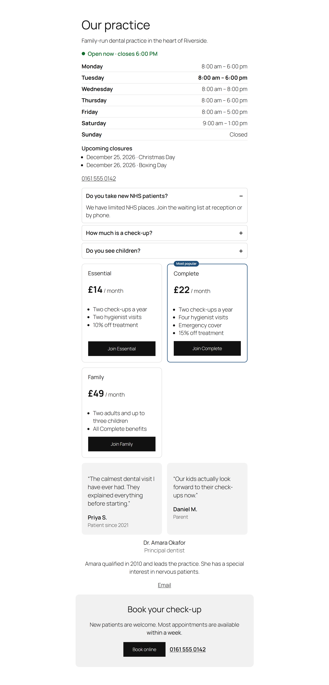
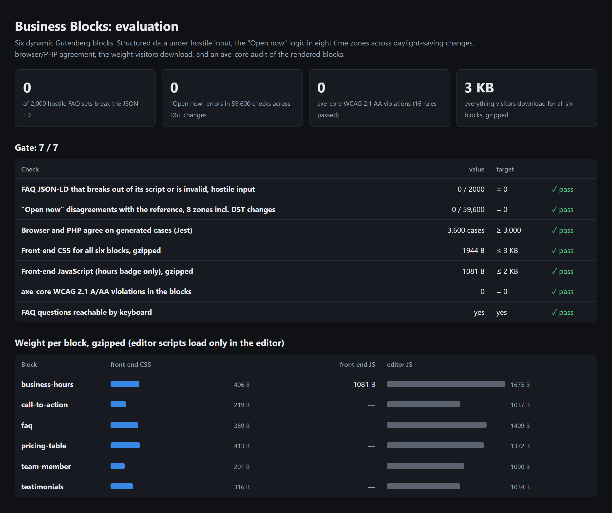
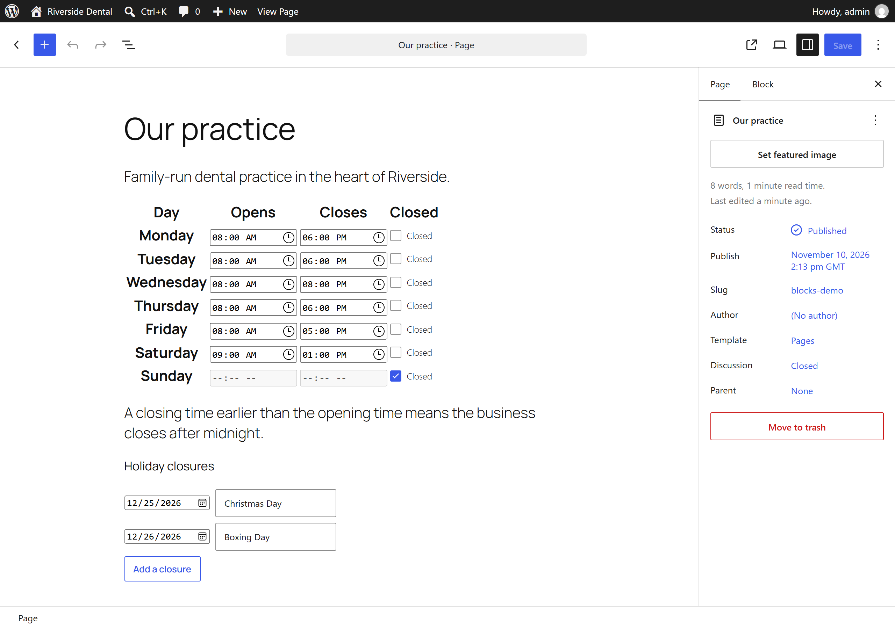

# Business Blocks for WordPress

[](https://github.com/codeROCK-IZZY/wordpress-business-blocks/actions/workflows/ci.yml)


Six Gutenberg blocks that small-business websites need on nearly every page, built with React and
`@wordpress/scripts` and rendered in PHP:

| Block | What it does |
|---|---|
| **Business hours** | Weekly hours, holiday closures, overnight hours, and a live **"Open now · closes 6 pm"** badge that stays correct on cached pages; `LocalBusiness` structured data (with a subtype such as `Dentist`) |
| **FAQ** | An accordion built on `<details>`/`<summary>` (keyboard and screen-reader friendly with no JavaScript), with `FAQPage` structured data |
| **Pricing table** | Plans side by side, a highlighted plan, features, and a button per plan with an accessible name |
| **Testimonials** | Quotes as `<figure>`/`<blockquote>`/`<figcaption>`, deliberately **without** review markup |
| **Team member** | Photo (alt text falls back to the name), role, bio, obfuscated email and LinkedIn link |
| **Call to action** | Heading, text, button and a tappable phone number |



## Results

From `php eval/run.php --gate`, the Jest suite and the integration run in CI:

| Check | Result |
|---|---:|
| FAQ structured data broken by hostile input (`</script>`, `<!--`, quotes, U+2028, event handlers…) | **0 of 2,000** |
| "Open now" disagreements with a minute-by-minute reference, 8 time zones, both daylight-saving changes | **0 of 59,600** |
| Browser (JavaScript) and server (PHP) agree on generated opening-hours cases | **3,600 of 3,600** |
| axe-core WCAG 2.1 A/AA violations in the rendered blocks | **0** (16 rules passed) |
| Everything a visitor downloads for all six blocks, gzipped | **3.0 KB** (1.9 KB CSS + 1.0 KB JS) |
| Plugin assets on a page that uses none of the blocks | **none** |

The property tests found two real bugs on the way, both now fixed and covered:

- **The night the clocks go forward.** For hours of 16:00–01:45, the closing time was computed as "01:45 today
  plus a day". On the day London's clocks jump from 01:00 to 02:00, 01:45 does not exist, PHP moves it to 02:45, and
  the badge said "open" for an extra hour on Monday morning. The closing time is now built on the next calendar
  date directly.
- **A time inside the gap.** The browser resolved a non-existent wall-clock time backwards while PHP moves it
  forwards; the parity test caught the single case out of 3,600, and the browser now follows PHP's rule.



## How it is built

- **Dynamic blocks.** Every block saves only its attributes (`save: () => null`) and is rendered by `render.php`,
  so markup can improve in an update without "This block contains unexpected or invalid content" in posts that use
  it.
- **Assets only where used.** `block.json` declares each block's style and the business-hours `viewScript`, so
  WordPress loads them only on pages containing the block (and inlines the small stylesheets). Editor scripts never
  reach visitors. A page without the blocks gets nothing from the plugin (checked over HTTP in CI).
- **"Open now" that survives page caching.** The server renders the status for visitors without JavaScript; a
  1 KB script recomputes it in the browser every minute from the schedule and the site's IANA time zone, using
  `Intl` for daylight-saving rules. The two implementations are kept in step by a generated parity test.
- **Structured data that cannot be hijacked.** JSON-LD is built as arrays and encoded with `JSON_HEX_TAG` and
  friends, so content such as `</script><script>…` in an FAQ answer stays inside the JSON. Business types are
  restricted to schema.org-style names. Testimonials get no `Review` markup, because self-published reviews of
  your own business are not eligible for review rich results.
- **Content safety.** Output is escaped with `esc_html`/`esc_url`/`wp_kses`; FAQ answers allow only links and
  basic formatting.

Design decisions are recorded in [docs/adr](docs/adr).



## Tests

| Layer | What runs |
|---|---|
| PHP unit (9 tests, 23,444 assertions) | Opening hours (overnight, closures, time formats, schema grouping) and a random-schedule property test against a minute-by-minute reference in five time zones; structured-data shape and escaping |
| Jest (6 tests) | Browser opening-hours logic on 3,600 PHP-generated cases, DST conversions, list helpers |
| Integration | WordPress 6.5 and latest: 15 checks inside WordPress (registration, JSON-LD, markup, hostile content, empty blocks) and 4 over HTTP (assets only where used, editor scripts never on the front end) |
| Accessibility | axe-core in Chromium on the rendered blocks, WCAG 2.1 A and AA |
| Static | ESLint and Stylelint (WordPress configs), WordPress Coding Standards 3, PHPStan level 8 |

## Run it

```bash
npm ci && npm run build
composer install
docker compose up -d && bash tests/integration/run.sh   # WordPress with a demo page using every block
# http://127.0.0.1:8080/blocks-demo/   (admin / admin)
```

```bash
npm test && npm run lint:js && npm run lint:css
vendor/bin/phpunit && vendor/bin/phpcs && vendor/bin/phpstan analyse
php eval/hours_cases.php        # regenerate the parity cases from PHP
php eval/run.php --gate         # writes eval/reports/
```

## Project layout

```
business-blocks.php          registers every block in build/blocks and the "Business" category
includes/Hours.php           opening hours: status, next change, closures, overnight, schema
includes/Schema.php          JSON-LD builders and the safe <script> encoder
src/blocks/<block>/          block.json, index.js, edit.js (React), render.php, style.scss (+ view.js for hours)
src/shared/                  hours.js (browser mirror of Hours.php), list.js (editor list helpers)
eval/                        evaluation, parity-case generator, axe-core audit
tests/unit/ tests/js/ tests/integration/
```

## Documentation

- [Architecture decisions](docs/adr)
- [Known limitations](docs/known-limitations.md)

The practice, people and prices in the demo are invented.

## License

GPL-2.0-or-later.
